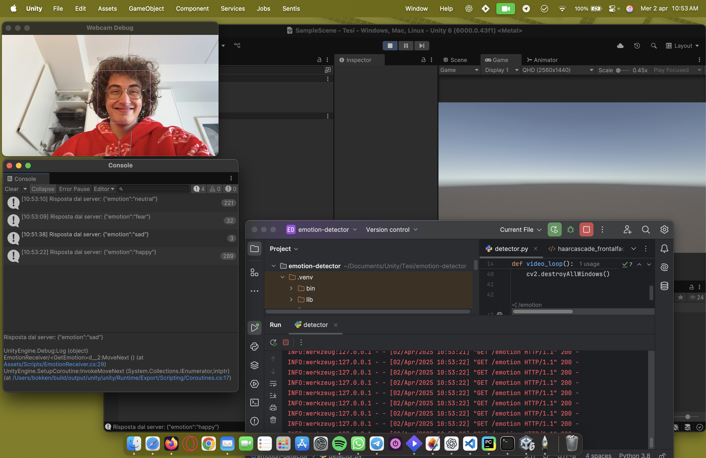
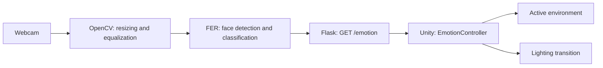

# Emotion Adaptive Environment

A Unity and Python prototype that adapts a 3D environment to facial expressions captured through a webcam. The system connects facial expression recognition to interactive scene changes, selecting geometry and lighting for six emotional states.

Developed as a bachelor's thesis project by **Giuseppe Cricrì**, it explores how games can respond to a player's perceived emotional state. The main contribution is the integration of a Python vision service with a Unity environment through a local REST API. Procedural assets draw on the related thesis work of **Sebastiano Tusa**.

The project demonstrates a complete path from webcam input to visual feedback. Its evaluation combines the implementation's timing parameters with user feedback on the proposed environments.

## Prototype in action



This screenshot shows an early integration test: the webcam feed displays the detected face, Python's FER classifier produces an expression label, and Flask exposes it as JSON. Unity deserializes the response into the `EmotionResponse.emotion` string, which the scene controller uses to select an environment.

## Features

- **Facial expression recognition:** detects a face and selects the highest-scoring expression returned by the pretrained FER model.
- **Adaptive environments:** switches between sets of objects associated with neutrality, happiness, surprise, fear, anger, and sadness.
- **Lighting transitions:** smoothly adjusts the main light's color, intensity, and orientation.
- **First-person exploration:** supports keyboard movement, mouse camera control, and wrap-around at the map boundaries.
- **Procedural asset integration:** includes Houdini assets, saved geometry, and an experimental script for updating procedural parameters through Houdini Engine.

Adaptive audio remains a proposed extension rather than an implemented feature.

## Architecture



The original [`detector.py`](emotion-detector/detector.py) reads the webcam through `cv2.VideoCapture(0)`, resizes frames to **480 pixels wide** while preserving their aspect ratio, equalizes the histogram, and calls `FER().detect_emotions(...)`. It uses the first detected face and selects the expression with the highest score. If no face is detected, it returns `no_face`.

Video capture and inference run in the main thread, while Flask runs in a separate thread. The archived implementation does not include the separate capture/inference threads and frame queue described in parts of the thesis.

[`EmotionController.cs`](Assets/EmotionController.cs) polls `GET http://127.0.0.1:5001/emotion`, disables the previous environment, and activates the one associated with the received label. It waits **4 seconds after each HTTP response** and interpolates lighting properties over **2 seconds**. Unity receives an expression label as JSON; webcam images stay within the Python process.

### Expression label compatibility

FER returns labels such as `happy`, `angry`, and `sad`, while the main Unity controller expects `happiness`, `anger`, and `sadness`. FER also includes `disgust`, whereas the scene has six environments. [`server.py`](emotion-detector/server.py) adapts the endpoint's labels while preserving the original detector:

| FER output | Unity label | Environment |
| --- | --- | --- |
| `neutral` | `neutral` | Neutrality |
| `happy` | `happiness` | Happiness |
| `surprise` | `surprise` | Surprise |
| `fear` | `fear` | Fear |
| `angry` | `anger` | Anger |
| `sad` | `sadness` | Sadness |
| `disgust`, `no_face` | `neutral` | Neutral fallback |

The neutral fallback is an explicit choice in this adapter. Running `detector.py` directly preserves FER's original labels; the Unity controller disables the current object when it receives an unmapped value.

## Performance and evaluation

The figures below distinguish parameters present in the source code from estimates and observations reported in the thesis. Benchmark logs and an annotated evaluation dataset are not included in this repository.

| Metric | Value | Evidence and interpretation |
| --- | --- | --- |
| Input width for FER | 480 px | Implemented in the detector |
| Main environment controller polling delay | 4 s after each request | Nominal upper bound of approximately 0.25 Hz, plus HTTP response time |
| Lighting transition | 2 s | Implemented in the controller |
| Experimental `HdaScript` and `EmotionReceiver` polling delay | 0.1 s after each request | Approximately 10 Hz nominally; separate from the main controller's polling rate |
| Unity rendering | 60 FPS target | Thesis design target, not a reproduced benchmark for this snapshot |
| Webcam capture | 30 FPS target | The archived detector does not explicitly set the camera's frame rate |
| Capture, preprocessing, inference, and HTTP | Approximately 80 ms | Thesis estimate: 33 + 5 + 40 + 2 ms |
| Analysis pipeline latency | Below 120 ms target | Design target, separate from Unity's polling delay |
| Network-to-scene latency | Below approximately 100 ms in the described trials | Thesis-reported observation; supporting logs and a detailed hardware configuration are unavailable |

The main controller's polling interval can add a delay approaching **4 seconds** before the environment changes, in addition to inference and network time. A visual response below 120 ms therefore cannot be claimed for the archived implementation. Reproducible measurements should separate inference time, HTTP response time, polling delay, environment activation, and Unity frame time on the target hardware.

### User feedback

The thesis questionnaire charts show **48 responses per question**. Participants evaluated screenshots of the environments. The table reports the share of respondents who answered **Yes** when asked whether each environment could produce its intended emotional effect:

| Intended effect | Positive responses |
| --- | --- |
| Alleviate sadness | 33.3% |
| Reduce anger | 20.8% |
| Ease fear | 29.2% |
| Evoke surprise and wonder | 58.3% |
| Enhance happiness | 37.5% |
| Maintain or strengthen neutrality | 43.8% |

The surprise environment received the strongest positive response. Positive responses for the other environments remained below 50%, suggesting that their visual design needs further iteration. These findings concern the perception of static images, rather than facial expression classification accuracy or the effect of playing the full interactive prototype.

### Recognition accuracy

The project uses a pretrained model distributed with FER. No project-specific accuracy, precision, recall, or confusion matrix is available. The thesis mentions approximately 90% accuracy in relation to public RAF-DB and FER2013 comparisons, but the accompanying figures show leaderboards for different models. **That figure is not a demonstrated accuracy result for the model used in this project.**

FER 22.5.1 documents a Keras model with HDF5 weights. The archived code does not explicitly configure a MobileNet-V2 or TensorFlow Lite model.

## Repository structure

| Path | Contents |
| --- | --- |
| `Assets/` | C# scripts, scenes, materials, HDRP resources, Houdini assets, and their `.meta` files |
| `Assets/Scenes/SampleScene.unity` | Main scene, enabled in the build settings |
| `Assets/Test.unity` | Experimental scene |
| `Assets/Plugins/HoudiniEngineUnity/` | Houdini Engine plugin included in the original project |
| `Assets/HoudiniEngineAssetCache/` | Saved Houdini geometry and prefabs retained as project assets |
| `Packages/` and `ProjectSettings/` | Unity dependencies and configuration |
| `emotion-detector/` | Original detector, cascade XML, HTTP adapter, and Python dependencies |
| `large-assets/` | Compressed assets, Git LFS archive parts, and a SHA-256 manifest |
| `tools/restore_assets.py` | Asset restoration and integrity verification |

Large files are stored as gzip archives split into parts of at most **512 MiB**, tracked with Git LFS. Restoration recreates the original files byte for byte, including meshes larger than 4 GB, and preserves Unity's asset references. The `.meta` files are versioned. Restored large files are ignored by Git because their archives represent them in the repository.

Generated Unity caches (`Library`, `Temp`, `Logs`), personal editor settings, generated IDE files, Python environments, and `node_modules` are excluded. The thesis PDF and PowerPoint presentation are also excluded.

## Running the project

### Requirements

- **Unity 6000.0.43f1**, as recorded in `ProjectSettings/ProjectVersion.txt`.
- **Git and Git LFS** to download the archive parts.
- **64-bit Python 3.10 or 3.11** for the reconstructed Python environment, plus an available webcam with camera permissions enabled.
- Disk space for approximately **30 GB of restored assets**, in addition to the archives, Python dependencies, and Unity's regenerated `Library`. Allow at least **70 GB** for initial setup; asset import may require more.
- To edit and regenerate procedural assets: **Houdini/Houdini Engine 20.5.584** with a license compatible with `.hdalc` assets. Saved geometry is included.

Unity Package Manager restores the project dependencies. The manifest includes HDRP and URP 17.0.4, Input System 1.13.1, and ML-Agents 3.0.0. Facial expression classification runs in Python; this repository does not include a training dataset or a custom model training workflow.

`requirements.txt` reconstructs an environment compatible with FER 22.5.1 and OpenCV 4.11.0.86. It uses FER's `opencv-contrib-python` dependency and pins TensorFlow/Keras to the 2.15 generation and MoviePy to the 1.x generation. It is not a lockfile of the original thesis environment. On native Windows, this configuration runs inference on the CPU.

### 1. Clone and restore the assets

```powershell
git lfs install
git clone https://github.com/CRICRICode/emotion-adaptive-environment.git
cd emotion-adaptive-environment
git lfs pull
py -3.11 tools/restore_assets.py
```

Restore the assets **before opening Unity**, with the editor closed. The script checks each archive part and restored file against its SHA-256 checksum. It recognizes assets that have already been restored and refuses to overwrite existing files with different contents. To verify the archives without extracting them:

```powershell
py -3.11 tools/restore_assets.py --check
```

### 2. Start the recognition service

```powershell
py -3.11 -m venv .venv
.\.venv\Scripts\python.exe -m pip install --upgrade pip
.\.venv\Scripts\python.exe -m pip install -r emotion-detector/requirements.txt
.\.venv\Scripts\python.exe emotion-detector/server.py
```

The service opens a `Webcam Debug` window and listens on `127.0.0.1:5001`. Initial startup loads the model bundled with FER. From a second terminal, check the endpoint:

```powershell
Invoke-RestMethod http://127.0.0.1:5001/emotion
```

Example response: `{"emotion":"happiness"}`. Press **Q** while the webcam window is focused to stop the detector. To select another camera, change the index in `cv2.VideoCapture(0)` inside the detector.

On macOS/Linux, use `python3.11` instead of `py -3.11` and `.venv/bin/python` instead of `.venv\Scripts\python.exe`. These commands describe the reconstructed environment; they do not indicate a new validation run on those platforms.

### 3. Open the Unity scene

1. Add the repository folder to Unity Hub and open it with **6000.0.43f1**.
2. Wait for package restoration and asset import to finish.
3. Open **`Assets/Scenes/SampleScene.unity`**.
4. With the Python service running, press **Play**.
5. Move with **WASD** and look around with the **mouse**. Environment changes appear at the next polling cycle.

The six environment references and the main light are assigned in the scene's `EmotionController` component. The project uses input mode `Both`, which supports the scripts that read axes from the legacy Input Manager. The scene called `CoreGame` in the thesis is stored here as `SampleScene`.

## Limitations and future work

The prototype analyzes the first detected face and is sensitive to lighting and webcam positioning. It selects the highest-scoring expression without a confidence threshold or temporal smoothing. `EmotionController` does not expose confidence scores or set an HTTP timeout. The original service uses a local Flask server and a shared variable, intended for a demonstration on a single computer.

Next steps include stabilizing predictions, collecting reproducible latency measurements, optimizing mesh size, and simplifying startup. Adaptive audio and evaluation during actual gameplay would extend the experience. Further architectural options discussed in the thesis include WebSocket delivery, configurable expression-to-environment mappings through ScriptableObjects, and centralized event handling.

## Credits and references

| Credit | Details |
| --- | --- |
| Author | Giuseppe Cricrì |
| Thesis | *Understanding and Adapting to Human Emotions in Game Engines Using Machine Learning* |
| Institution | Università degli Studi Link Roma |
| Degree program | Innovative Technologies for Digital Communications |
| Academic year | 2024/2025 |
| Supervisor | Andrea Leganza |
| Related procedural asset work | Sebastiano Tusa |

The project description and questionnaire results are based on chapters 5 and 6 of the thesis, particularly sections 5.2, 5.3, and 6.2. Implementation details are documented from the archived source code.

- [FER 22.5.1: output, model, and usage](https://pypi.org/project/fer/22.5.1/)
- [Unity](https://unity.com/) and [Houdini Engine for Unity documentation](https://www.sidefx.com/docs/unity/)
- [Git LFS and GitHub file size limits](https://docs.github.com/en/repositories/working-with-files/managing-large-files/about-git-large-file-storage)
- [TensorFlow installation](https://www.tensorflow.org/install/pip)

Third-party components retain their respective notices and licenses. The included Houdini Engine plugin preserves the copyright notices of Side Effects Software. This repository does not assign a new license to the academic work or procedural assets.
